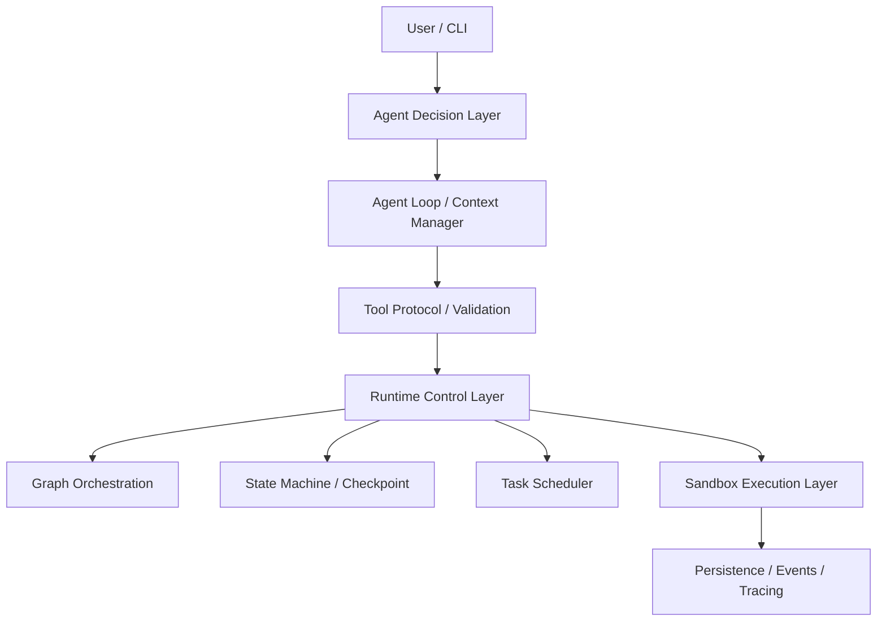

# AI Agent Journey

> **Build Your Agent. Level Up Your Engineering Skills.**

这是一个公开的技术学习与工程实践项目,分为两个相互衔接的阶段:

- **Season 1 — Agent Awakening(原理觉醒)**:用故事、生活比喻和技术图解,理解 AI Agent 的核心机制,并输出适合公开分享的原创技术文章。
- **Season 2 — Agent Engineering(工程进化)**:基于第一季理解的原理,从零构建 Mini Coding Agent Runtime。

每完成一关,你的 Mini Agent 就真实地多一项能力,你也多掌握一组核心工程原理。

---

## 两季整体规划

| | Season 1 — 原理觉醒 | Season 2 — 工程进化 |
|---|---|---|
| 目标 | 理解原理,形成准确的技术直觉 | 动手构建 Agent Runtime |
| 形式 | 故事 + 比喻 + 原理图 + Boss 思考题 | 九关工程路线 + 代码 + 自动化测试 |
| 产出 | 公众号长文 / 朋友圈短文 / X Thread | 可运行的 Demo、测试、Benchmark 报告 |
| 当前状态 | 前三篇提纲完成 | 工程初始化完成,九关待建 |

原理与工程一一对应:第一季讲清楚「为什么」,第二季证明「怎么做」。

## Season 1 — Agent Awakening(原理觉醒)

通过游戏化闯关、故事、生活比喻与技术图解,让开发者理解 AI Agent 从底层原理到上层应用的核心机制。

每篇遵循统一叙事:**有趣的问题 → 生动的故事 → 真实的技术原理 → 一个具体例子 → Boss 挑战 → 一句话总结**。

| 篇目 | 技术主题 | 一句话口诀 | 状态 |
|---|---|---|---|
| [S1-EP00 — 从零养成一个 AI Agent](content/season-1/ep00/) | 系列开篇 | 从只会聊天,到真正能做事——一起解锁 AI Agent 的九种能力。 | 提纲完成 |
| [S1-L0 — 给 AI Agent 装上手脚](content/season-1/level-0/) | Agent Harness / Tool Calling | LLM 负责决策,Harness 负责管控,Tool 负责执行 | 提纲完成 |
| [S1-L1 — 让 Agent 学会连续行动](content/season-1/level-1/) | Agent Loop | 决策、行动、观察,止于目标或预算 | 提纲完成 |

内容目录:[content/season-1/](content/season-1/) — 正文确定后按需增加 `article.md`(公众号)/ `moments.md`(朋友圈)/ `x-thread.md`(X)。

## Season 2 — Agent Engineering(工程进化)

### 世界观

你是 **Agent Architect(智能体架构师)**。

Mini Agent 刚刚诞生——它能接收指令,却无法触碰外部世界。你的任务是陪它走过九关:每通关一次,它解锁一项新能力,你掌握一组核心工程原理,项目留下一个可运行的 Demo、一组通过的测试、一场打赢的 Boss 故障战,和一个 Git 里程碑。

### 九关技术地图

| 编号 | 关卡 | 技术主题 | 解锁能力 | Milestone | 状态 |
|---|---|---|---|---|---|
| S2-L0 | ⚡ 智能觉醒 | Minimal Agent Harness | Tool Calling | `v0.1.0` | 🛡️ |
| S2-L1 | 🧠 自主意识 | Agent Loop | Autonomous Multi-step Execution | `v0.2.0` | 🔒 |
| S2-L2 | 🛠️ 代码工匠 | Mini Coding Agent | Code Editing | `v0.3.0` | 🔒 |
| S2-L3 | 🛡️ 安全堡垒 | Linux Sandbox Executor | Sandboxed Execution | `v0.4.0` | 🔒 |
| S2-L4 | 💾 时间回溯 | State Machine + Checkpoint | Crash Recovery | `v0.5.0` | 🔒 |
| S2-L5 | 🗺️ 命运之图 | Graph Orchestration | Workflow Orchestration | `v0.6.0` | 🔒 |
| S2-L6 | 🏰 指挥中心 | Mini AgentOS | Task Management & Scheduling | `v0.7.0` | 🔒 |
| S2-L7 | 🔌 能力之门 | MCP / Skills | Extensible Tool Ecosystem | `v0.8.0` | 🔒 |
| S2-L8 | 🏆 终极试炼 | Evaluation / Benchmark | Measurable Reliability | `v0.9.0` | 🔒 |

每关的工程任务书(任务、架构、Boss 战、胜利条件)在 [`docs/levels/`](docs/levels/)。

### 技术架构总览



概念视图与七组关键概念辨析(Agent vs Harness vs Runtime vs Infra 等)见 [docs/architecture.md](docs/architecture.md)。

### GitHub 工程成果

> 只展示真实运行过的东西:每个条目都有可复现的命令与测试证据。

| 里程碑 | 内容 | 证据 |
|---|---|---|
| 工程初始化 | 目录结构、任务书、进度与成就系统(commit `93b78c7`) | [docs](docs/) |
| Level 0 — v0.1.0(2026-11-11) | ToolCall 协议、Schema 校验、白名单 Registry、Dispatcher、权限模型、脱敏 Trace、echo / read_file 工具、单轮 Harness、Mock + Anthropic 双客户端 | `pytest` 109 passed / 1 skipped(未运行的 live 用例)、`pytest tests/boss` 10 passed、[Demo 运行记录](docs/levels/level-0.md)、tag `v0.1.0` |

### 成就系统

每关独立评定三个等级:

- 🛡️ **Builder** — 工程通关(Demo + 测试 + Boss 战 + Git 提交)
- 🛠️ **Engineer** — Builder + 个人掌握(讲清链路、指出关键代码、独立修改、预测故障)
- 👑 **Master** — Engineer + 高难度挑战

九枚关卡成就从 **First Contact** 到 **Runtime Master**,全部以证据解锁:[docs/achievements.md](docs/achievements.md)。

## 学习与贡献方式

**跟内容(Season 1)**:从 [content/season-1/EP00](content/season-1/ep00/) 读起,每篇读完做一道 Boss 思考题。

**跟工程(Season 2)**:

```bash
git clone https://github.com/liutongzhu/ai-agent-journey.git
cd ai-agent-journey
python3 -m venv .venv && source .venv/bin/activate    # Python 3.11+
pip install -e ".[dev]"
pytest                                                 # 运行全部测试
```

学习循环:

```text
理解核心原理 → 构建最小实现 → 运行 Demo → 阅读关键代码
    → 主动制造故障 → 修复与验证 → 通关
```

**贡献**:欢迎通过 Issue / PR 指出比喻不当、原理错误、工程缺陷或改进建议;内容类贡献请先阅读 [content/season-1 的创作原则](content/season-1/README.md)。

## 工程与安全原则

模型输出属于不可信输入。本项目遵循一组工程红线(完整 20 条见 [docs/engineering-principles.md](docs/engineering-principles.md)):

- ToolCall 严格校验,Registry 白名单,不使用 `shell=True`
- 文件操作限定工作区边界;Sandbox 启动失败一律 Fail Closed
- 权限审批与执行隔离是两种机制,互不替代
- 不泄露 API Key;不虚构测试结果与性能数据

## 技术栈与依赖约束

- Python 3.11+ / 标准库优先 / pytest / Git
- 按需引入:Bubblewrap(Level 3)、SQLite(Level 4)、MCP SDK(Level 7)、Rust(未来扩展)
- 不提前引入:LangChain / LangGraph / 大型 Workflow 框架 / 消息队列 / 前端 / 游戏引擎

## 参考开源项目

阅读参考(本项目不依赖这些框架,核心机制全部手写):

- [Claude Code](https://github.com/anthropics/claude-code) — Agent Harness 与工具系统设计
- [SWE-agent](https://github.com/SWE-agent/SWE-agent) — Coding Agent 接口设计
- [OpenHands](https://github.com/All-Hands-AI/OpenHands) — 沙箱执行与任务编排
- [LangGraph](https://github.com/langchain-ai/langgraph) — Graph Orchestration 概念对照

---

*本项目为技术学习与工程实践项目。所有公开内容只包含技术知识、学习心得、工程实践、开源项目与技术交流。*
