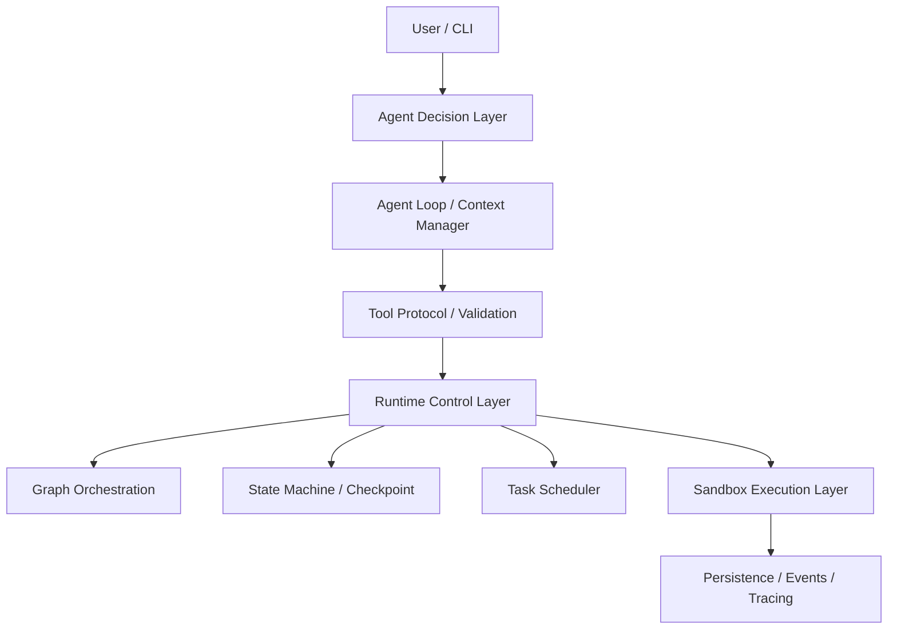

# AI Agent Journey

> **Build Your Agent. Level Up Your Engineering Skills.**

从零构建一个 **Mini Coding Agent Runtime**，通过九个逐步升级的工程关卡，理解并亲手实现 Agent Harness、Runtime、Orchestration、Sandbox 与 Agent Infrastructure 的核心机制。

这不是教程合集，而是一个持续演进、真实可运行的项目：每完成一关，你的 Mini Agent 就真实地多一项能力。

---

## 世界观

你是 **Agent Architect（智能体架构师）**。

Mini Agent 刚刚诞生——它能接收指令，却无法触碰外部世界。你的任务是陪它走过九关：每通关一次，它解锁一项新能力，你掌握一组核心工程原理，项目留下一个可运行的 Demo、一组通过的测试、一场打赢的 Boss 故障战，和一个 Git 里程碑。

游戏化只负责讲述，技术概念绝不被命名掩盖。

## 当前玩家状态

| Player | Player Level | 进度 | Total XP | 当前任务 |
|---|---|---|---|---|
| Agent Architect | 0 | 0 / 9 | 0 | ⚡ Level 0 — 智能觉醒 |

详细进度与 XP 规则见 [docs/progress.md](docs/progress.md)。

## 九关冒险地图

| # | 关卡 | 技术主题 | 解锁能力 | Milestone | 状态 |
|---|---|---|---|---|---|
| 0 | ⚡ 智能觉醒 | Minimal Agent Harness | Tool Calling | `v0.1.0` | 🔄 当前 |
| 1 | 🧠 自主意识 | Agent Loop | Autonomous Multi-step Execution | `v0.2.0` | 🔒 |
| 2 | 🛠️ 代码工匠 | Mini Coding Agent | Code Editing | `v0.3.0` | 🔒 |
| 3 | 🛡️ 安全堡垒 | Linux Sandbox Executor | Sandboxed Execution | `v0.4.0` | 🔒 |
| 4 | 💾 时间回溯 | State Machine + Checkpoint | Crash Recovery | `v0.5.0` | 🔒 |
| 5 | 🗺️ 命运之图 | Graph Orchestration | Workflow Orchestration | `v0.6.0` | 🔒 |
| 6 | 🏰 指挥中心 | Mini AgentOS | Task Management & Scheduling | `v0.7.0` | 🔒 |
| 7 | 🔌 能力之门 | MCP / Skills | Extensible Tool Ecosystem | `v0.8.0` | 🔒 |
| 8 | 🏆 终极试炼 | Evaluation / Benchmark | Measurable Reliability | `v0.9.0` | 🔒 |

每关的任务书（任务、架构、Boss 战、胜利条件）在 [`docs/levels/`](docs/levels/)。

## 技术架构总览



概念视图与七组关键概念辨析（Agent vs Harness vs Runtime vs Infra 等）见 [docs/architecture.md](docs/architecture.md)。

## 当前主线任务

**⚡ Level 0 — 智能觉醒**：Mini Agent 刚刚诞生，却无法触碰外部世界。为它打造第一套工具系统——ToolCall 协议、Schema 校验、Tool Registry、Dispatcher、echo 工具与结构化 Trace，完成第一次真实工具调用。

任务书：[docs/levels/level-0.md](docs/levels/level-0.md)

## 如何开始冒险

```bash
git clone https://github.com/liutongzhu/ai-agent-journey.git
cd ai-agent-journey
python3 -m venv .venv && source .venv/bin/activate    # Python 3.11+
pip install -e ".[dev]"
pytest                                                 # 运行全部测试
```

学习循环：

```text
理解核心原理 → 构建最小实现 → 运行 Demo → 阅读关键代码
    → 主动制造故障 → 修复与验证 → 通关
```

## 真实工程成果

> 本项目坚持「只展示真实运行过的东西」：每个条目都有可复现的命令与测试证据。

| 里程碑 | 内容 | 证据 |
|---|---|---|
| （暂无） | 初始化阶段，尚无关卡通关 | — |

## 成就系统

每关独立评定三个等级：

- 🛡️ **Builder** — 工程通关（Demo + 测试 + Boss 战 + Git 提交）
- 🛠️ **Engineer** — Builder + 个人掌握（讲清链路、指出关键代码、独立修改、预测故障）
- 👑 **Master** — Engineer + 高难度挑战

九枚关卡成就从 **First Contact** 到 **Runtime Master**，全部以证据解锁：[docs/achievements.md](docs/achievements.md)。

## 安全原则

模型输出属于不可信输入。本项目遵循一组工程红线（完整 20 条见 [docs/engineering-principles.md](docs/engineering-principles.md)）：

- ToolCall 严格校验，Registry 白名单，不使用 `shell=True`
- 文件操作限定工作区边界；Sandbox 启动失败一律 Fail Closed
- 权限审批与执行隔离是两种机制，互不替代
- 不泄露 API Key；不虚构测试结果与性能数据

## 技术栈与依赖约束

- Python 3.11+ / 标准库优先 / pytest / Git
- 按需引入：Bubblewrap（Level 3）、SQLite（Level 4）、MCP SDK（Level 7）、Rust（未来扩展）
- 不提前引入：LangChain / LangGraph / 大型 Workflow 框架 / 消息队列 / 前端 / 游戏引擎

## 参考开源项目

阅读参考（本项目不依赖这些框架，核心机制全部手写）：

- [Claude Code](https://github.com/anthropics/claude-code) — Agent Harness 与工具系统设计
- [SWE-agent](https://github.com/SWE-agent/SWE-agent) — Coding Agent 接口设计
- [OpenHands](https://github.com/All-Hands-AI/OpenHands) — 沙箱执行与任务编排
- [LangGraph](https://github.com/langchain-ai/langgraph) — Graph Orchestration 概念对照

---

*本项目为技术学习与工程实践项目。所有公开文档只讨论技术、学习任务、工程成果与开源协作。*
