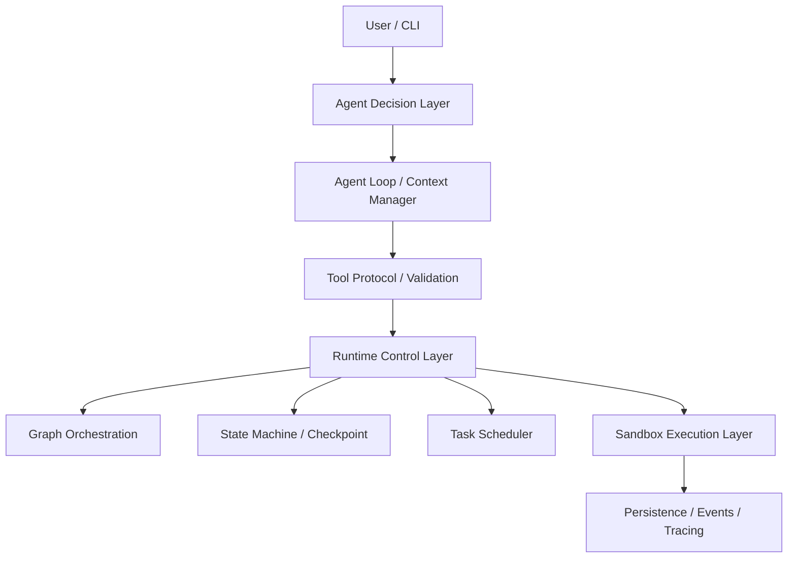

# Architecture — 统一工程架构

> 这是概念视图，说明各层职责与边界，不要求代码严格按单向流水线实现。
> 硬性约束：共享统一的基础数据模型，避免出现两套平行执行系统。

## 分层架构图

## 演进时间线（哪一关点亮哪一层）

| 层 / 模块 | 点亮于 | 代码位置 |
|---|---|---|
| Tool Protocol / Validation / Registry | Level 0 | `tools/` |
| Agent Loop / Context Manager / LLM Adapter | Level 1 | `agent/` |
| 文件工具（挂载在 Tool Protocol 之上） | Level 2 | `tools/` |
| Sandbox Execution Layer | Level 3 | `sandbox/` |
| State Machine / Checkpoint / Event Log | Level 4 | `runtime/` |
| Graph Orchestration | Level 5 | `orchestration/` |
| Task Scheduler（FIFO / 并发 / 取消） | Level 6 | `runtime/` |
| 外部工具生态（MCP / Skills） | Level 7 | `tools/` |
| Evaluation / Benchmark | Level 8 | `runtime/` + `tests/` |
| Persistence / Events / Tracing | 贯穿全程，Level 4 起系统化 | `runtime/` |

## 关键概念辨析

### 1. Agent、Harness、Runtime、Infra 的区别

- **Agent**：决策本体——模型 + 策略，决定「下一步做什么」。
- **Harness**：连接模型与外部世界的协议层——把模型输出变成合法的 ToolCall，把工具结果回填为 Observation（校验、派发、上下文组装）。
- **Runtime**：一次 Run 的生命周期管理者——状态机、Checkpoint、事件、调度、恢复。
- **Infra**：执行与持久化底座——Sandbox、存储、Trace、未来的分布式设施。Agent 在 Harness 里说话，在 Runtime 里活着，在 Infra 上奔跑。

### 2. Agent Loop 与 Graph Orchestration 的区别

- **Agent Loop**：单个任务内部的「决策 → 行动 → 观察」小循环，步数由模型和预算动态决定，控制流**不预先确定**。
- **Graph Orchestration**：显式的流程拓扑，节点与边预先声明，走向由条件路由决定，控制流**部分预先确定**。
- 二者是包含关系而非替代关系：Graph Node 内部可以驱动一个 Agent Loop（例如 Code 节点内跑多步编码）。

### 3. Orchestration 与 Task Scheduling 的区别

- **Orchestration**：回答「一个工作流**内部**，下一个节点是谁」。
- **Scheduling**：回答「**多个任务之间**，谁先占资源、并发多大、如何排队与取消」。
- 简单记法：Orchestration 管流程形状，Scheduling 管资源秩序。

### 4. Runtime 与 Sandbox Executor 的边界

- Runtime 决定「做什么、什么时候做、做砸了怎么办」（语义层）。
- Sandbox Executor 只回答「如何安全地执行一条命令」——进程启动、隔离、超时、清理，它**不知道任务语义**。
- 接口契约：`run(cmd, limits) -> (exit_code, stdout, stderr, meta)`。边界之上谈任务，边界之下谈进程。

### 5. Checkpoint 与 Event Log 的区别

- **Checkpoint**：某一时刻状态的**快照**，回答「现在到哪了」，用于恢复——读它继续。
- **Event Log**：不可变的**事实序列**，回答「发生过什么」，用于审计与重放——只追加。
- 恢复靠 Checkpoint，解释历史靠 Event Log；两者互不替代。

### 6. Permission Policy 与 Sandbox Isolation 的区别

- **Permission Policy**：决策层的「允不允许」——细粒度策略与人工审批，**事前**控制。
- **Sandbox Isolation**：执行层的「伤不到」——即使策略失误、进程失控，宿主也安全，**事中**兜底。
- 两者互补不可替代：审批不隔离，隔离不审批。MCP 外部工具属于权限策略的信任边界（Level 7）。

### 7. Execution Success 与 Task Success 的区别

- **Execution Success**：一次工具调用/命令「跑完了」——进程退出、退出码可控（0 或已知非 0）。
- **Task Success**：「目标真实达成」——测试真的通过、产物真的正确。
- 工具执行成功 ≠ 任务成功。Level 8 的评估度量的始终是后者，这也是本项目反对「演示即可靠」的原因。

## 统一数据模型

`Run / Step / Event / ToolResult` 在 `runtime/` 中定义**一次**，被 Agent Loop、Graph Engine、Task Scheduler 共享复用：

- Graph Node 可以调用 Agent Loop；Agent Loop 不知道 Graph 的存在（单向依赖）。
- Task Scheduler 调度的是 Run；Run 内部可以是 Loop 也可以是 Graph。
- 任何执行都产生 Event；任何对副作用敏感的步骤都有 ToolResult 落库（Level 4 起强制）。

## 工程红线

完整清单见 [engineering-principles.md](engineering-principles.md)。最重要的三条：

1. 模型输出属于不可信输入，ToolCall 必须严格校验。
2. Sandbox 启动失败必须 Fail Closed，不退化到无隔离执行。
3. 不虚构测试结果与性能指标——报告里的每个数字都要能复现。
