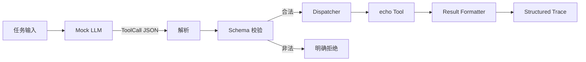

# Level 0 — ⚡ 智能觉醒

> 技术主题：Minimal Agent Harness ｜ 解锁能力：Tool Calling ｜ 状态：🛡️ Builder（工程通关 2026-11-11）

## Mission Briefing

Mini Agent 刚刚诞生。它能听懂指令，却没有双手——看得见任务，却无法触碰外部世界。你要为它打造第一套工具系统：一份工具契约（Protocol）、一间白名单工具库（Registry），和一台把调用派发到真实执行的机器（Dispatcher）。当第一声 `echo` 从工具侧传回结果时，Mini Agent 与真实世界的第一次握手就完成了。

## Main Quest

- 定义 ToolCall 协议（含 `protocol_version` 字段）与统一结果格式。
- 实现 JSON 解析与 Schema 校验：必填字段、参数类型、拒绝多余参数。
- 实现 Tool Registry（白名单注册）与 Dispatcher。
- 实现 `echo` 工具与 Result Formatter。
- 接入 Mock LLM，驱动一次完整的「指令 → ToolCall → 校验 → 执行 → 结构化结果」。
- 输出结构化 Trace，可还原一次工具调用的完整轨迹。

## Skills Unlocked

1. ToolCall Protocol 设计（含版本字段）
2. JSON 解析与 Schema 校验
3. Tool Registry（白名单）与 Dispatcher
4. 结构化 Trace / 日志

## Architecture



## Build

| 模块 | 位置 | 说明 |
|---|---|---|
| ToolCall 协议与校验 | `tools/protocol.py` | 信封解析（含 `protocol_version`、大小上限）、`ToolCall`/`ToolResult`、稳定错误码 |
| Schema 校验 | `tools/schema.py` | 最小 JSON Schema 子集：required / additionalProperties=false / 类型 / maxLength |
| Tool Registry | `tools/registry.py` | 白名单注册，注册时校验命名与 Schema 子集 |
| Dispatcher | `tools/dispatcher.py` | 查找 → Schema 校验 → 权限 → 超时执行 → 结构化结果 |
| 权限模型 | `tools/dispatcher.py` | `PermissionPolicy` 声明式白名单（`fs.read`） |
| 结构化 Trace | `tools/trace.py` | 事件序列 + 脱敏（敏感键 `[REDACTED]`、长值截断） |
| echo Tool | `tools/echo.py` | 第一个真实工具 |
| read_file Tool | `tools/read_file.py` | 工作区边界：resolve + `is_relative_to`，防目录穿越与符号链接越界 |
| LLM Adapter | `agent/llm.py` | `AnthropicLLMClient`（原生 tool_use 结构化调用，标准库 urllib）+ `MockLLMClient`（确定性脚本） |
| 单轮 Harness | `agent/harness.py` | 决策 → 工具执行 → 结果回传 → 最终回答（非 Agent Loop） |
| Demo 入口 | `examples/level0_echo_demo.py` | 默认 mock；`--live` 走真实 API（需 Key，缺失时 fail closed） |
| 测试 | `tests/level0/` + `tests/boss/` | 功能 99 通过 + Boss 战 10 通过 |

## Run

以下为 2026-11-11 的真实运行记录（Python 3.14.6 / macOS）。

```bash
python -m venv .venv && source .venv/bin/activate
pip install -e ".[dev]"
pytest                      # 109 passed, 1 skipped
pytest tests/level0 -v      # 99 passed, 1 skipped
pytest tests/boss -v        # 10 passed
python -m examples.level0_echo_demo
```

> skipped 的 1 条是 `test_real_structured_tool_call`（真实网络用例，`ANTHROPIC_API_KEY`
> 未设置时跳过，不会被标记为通过）。live 模式在无 Key 时如实拒绝启动：
> `demo failed: ANTHROPIC_API_KEY is not set; live mode refuses to start (fail closed)`。

Demo（mock 模式，确定性脚本，未调用真实模型）真实输出：

```text
workspace: /var/folders/.../level0-workspace-_56kfyp2
mode: mock(确定性脚本,未调用真实模型)
task: 复述一句话并读取 sample.txt

== trace ==
[trace] event=run_started mode=single_round
[trace] event=llm_decision tool_calls=2 has_text=False
[trace] event=tool_call_received call_id=call_1 tool=echo
[trace] event=tool_executed call_id=call_1 tool=echo status=ok duration_ms=0
[trace] event=tool_call_received call_id=call_2 tool=read_file
[trace] event=tool_executed call_id=call_2 tool=read_file status=ok duration_ms=0
[trace] event=run_finished tool_executed=True
== tool results ==
{"protocol_version": 1, "call_id": "call_1", "tool": "echo", "status": "ok", "output": "hello from level 0", "duration_ms": 0}
{"protocol_version": 1, "call_id": "call_2", "tool": "read_file", "status": "ok", "output": "hello from level 0\n第一声 echo 来自主工具区。", "duration_ms": 0}
== final answer ==
echo 返回与输入一致;sample.txt 内容为 'hello from level 0 / 第一声 echo 来自主工具区。'
```

## Key Code

最关键的一段：`tools/dispatcher.py` 中 `Dispatcher.execute`（110–152 行）——「查找 → Schema 校验 → 权限 → 超时执行 → 异常捕获 → 结构化结果」。它决定了非法调用如何被拒绝（`unknown_tool` / `schema_violation` / `permission_denied` / `timeout` / `tool_error`）、合法调用如何被执行，并把一切失败转成可追踪的统一 `ToolResult`，绝不向模型外泄堆栈。配套的边界防线在 `tools/read_file.py` 的 `_resolve_in_workspace`（先 resolve 再 `is_relative_to`，边界检查先于存在性检查）。

## Boss Challenge

构造五类非法调用，全部应被明确拒绝且原因可追踪（用测试固化）：

1. 非法 JSON
2. 未注册工具名
3. 参数类型错误
4. 多余参数
5. 超长输入

## Victory Conditions

- [x] 合法 ToolCall 成功执行并返回结果（`tests/level0/test_dispatcher.py::test_echo_happy_path`）
- [x] 五类非法调用均被明确拒绝（`tests/boss/test_level0_boss.py::TestBossFiveIllegalCalls`）
- [x] `pytest tests/level0 tests/boss -v` 全部通过（99 + 10 passed，1 skipped 为未运行的 live 用例）
- [x] 结构化 Trace 能还原一次完整工具调用（`test_dispatcher.py::test_trace_restores_full_call`、`test_harness.py::test_full_chain_tool_call_to_final_answer`）
- [x] 未使用 `shell=True`（Boss 战静态守卫 `TestSecurityGuards` 扫描 `tools/`、`agent/` 源码）
- [x] 协议含 `protocol_version` 字段（版本不匹配返回 `unsupported_version`，字符串 `"1"` 亦拒绝）

## Personal Mastery

- 解释：ToolCall 协议为什么需要版本字段？校验应该发生在执行前还是执行后，为什么？
- 指出：最关键的 20–50 行代码，并说明理由。
- 修改：独立新增一个 `upper` 工具（不借助 AI），走完注册与调用全链路。
- 预测：修改一处校验逻辑，先预测 Boss 测试哪几条会失败，再运行验证。

## Rewards

| 项目 | 值 |
|---|---|
| XP 上限 | 100 |
| 成就 | **First Contact** — 第一次工具调用 |
| 成就等级 | Builder / Engineer / Master |
| Milestone | `v0.1.0`（工程通关后才创建） |

## Learning Notes

### 运行记录（2026-11-11，工程实现）

- 实现路径：模型 API 原生结构化 Tool Calling（`tools` + `tool_use` block），不解析模型文本 JSON；信封解析层（`parse_tool_call`）作为任意原始传输的防御边界，Boss 战直接对它构造五类非法载荷。
- 期间发现并修复的真实问题：仓库脚手架的 `pip install -e ".[dev]"` 此前从未真正成功（setuptools flat-layout 多顶层目录报错），本次显式声明 `packages` 修复——文档里的命令必须真实跑过才算数。
- 已知边界（诚实记录）：Level 0 的超时只是放弃等待，不终止工具线程；路径校验是约束而非隔离，真正的执行隔离在 Level 3 Sandbox。
- Personal Mastery（解释 / 指出 / 修改 / 预测）尚未完成，待学习者本人完成后记录。
