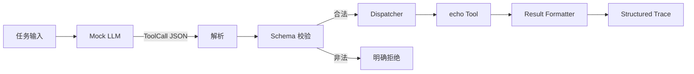

# Level 0 — ⚡ 智能觉醒

> 技术主题：Minimal Agent Harness ｜ 解锁能力：Tool Calling ｜ 状态：未开始

## Mission Briefing

Mini Agent 刚刚诞生。它能听懂指令，却没有双手——看得见任务，却无法触碰外部世界。你要为它打造第一套工具系统：一份工具契约（Protocol）、一间白名单工具库（Registry），和一台把调用派发到真实执行的机器（Dispatcher）。当第一声 `echo` 从工具侧传回结果时，Mini Agent 与真实世界的第一次握手就完成了。

## Main Quest

- 定义 ToolCall 协议（含 `protocol_version` 字段）与统一结果格式。
- 实现 JSON 解析与 Schema 校验：必填字段、参数类型、拒绝多余参数。
- 实现 Tool Registry（白名单注册）与 Dispatcher。
- 实现 `echo` 工具与 Result Formatter。
- 接入 Mock LLM，驱动一次完整的「指令 → ToolCall → 校验 → 执行 → 结构化结果」。
- 输出结构化 Trace，可还原一次工具调用的完整轨迹。

## Skills Unlocked

1. ToolCall Protocol 设计（含版本字段）
2. JSON 解析与 Schema 校验
3. Tool Registry（白名单）与 Dispatcher
4. 结构化 Trace / 日志

## Architecture



## Build

| 模块 | 位置 | 说明 |
|---|---|---|
| ToolCall 协议与校验 | `tools/` | 数据结构 + 校验器 |
| Tool Registry / Dispatcher | `tools/` | 白名单注册与派发 |
| echo Tool | `tools/` | 第一个真实工具 |
| Mock LLM | `agent/` | 生成确定性的 ToolCall JSON |
| Demo 入口 | `examples/level0_echo_demo.py` | 一次完整调用 |
| 测试 | `tests/level0/` + `tests/boss/` | 正常路径 + Boss 战 |

## Run

> 以下为**计划中**的运行方式。Demo 实现后，用真实输出替换本节。

```bash
python -m examples.level0_echo_demo
pytest tests/level0 -v
```

预期输出（示意，非真实结果）：

```text
[trace] protocol_version=1 tool=echo status=ok duration_ms=...
result: {"echo": "..."}
```

## Key Code

建议重点阅读（实现后补充具体行号）：`tools/` 中 Dispatcher 的「查找 → 校验 → 执行 → 异常捕获」主干，约 20–50 行。这段代码决定了非法调用如何被拒绝、合法调用如何被执行。

## Boss Challenge

构造五类非法调用，全部应被明确拒绝且原因可追踪（用测试固化）：

1. 非法 JSON
2. 未注册工具名
3. 参数类型错误
4. 多余参数
5. 超长输入

## Victory Conditions

- [ ] 合法 ToolCall 成功执行并返回结果
- [ ] 五类非法调用均被明确拒绝
- [ ] `pytest tests/level0 tests/boss -v` 全部通过
- [ ] 结构化 Trace 能还原一次完整工具调用
- [ ] 未使用 `shell=True`
- [ ] 协议含 `protocol_version` 字段或明确的兼容策略

## Personal Mastery

- 解释：ToolCall 协议为什么需要版本字段？校验应该发生在执行前还是执行后，为什么？
- 指出：最关键的 20–50 行代码，并说明理由。
- 修改：独立新增一个 `upper` 工具（不借助 AI），走完注册与调用全链路。
- 预测：修改一处校验逻辑，先预测 Boss 测试哪几条会失败，再运行验证。

## Rewards

| 项目 | 值 |
|---|---|
| XP 上限 | 100 |
| 成就 | **First Contact** — 第一次工具调用 |
| 成就等级 | Builder / Engineer / Master |
| Milestone | `v0.1.0`（工程通关后才创建） |

## Learning Notes

> 完成后在此记录：原理理解、关键代码摘录、运行记录、Boss 战故障分析、下一步。
