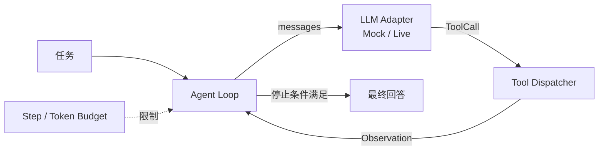

# Level 1 — 🧠 自主意识

> 技术主题：Agent Loop ｜ 解锁能力：Autonomous Multi-step Execution ｜ 状态：未开始

## Mission Briefing

Mini Agent 拥有了双手，却仍在机械等待——调用一次工具就停下，等着下一道指令。真正的智能体应当自己决定下一步：观察结果、调整计划、继续行动，直到任务完成。你要为它构建一颗会循环的心脏：Agent Loop。当它在确定性测试里走出多步、又在真实模型面前稳住阵脚时，它不再是一件工具，而是一个行动者。

## Main Quest

- 实现 LLM Adapter：统一 Mock 与真实 API 两种后端的调用接口。
- Deterministic Mode：可预测的 Mock LLM 输出，稳定驱动测试。
- Live Mode：真实 LLM API（Function Calling），凭据只来自环境变量。
- 实现 Agent Loop：模型决策 → 工具执行 → Observation 回填 → 下一轮。
- 维护会话历史与上下文预算（Token / Step Budget）。
- 定义停止条件与错误处理：最终回答 / API 失败 / 工具失败三条路径。

## Skills Unlocked

1. Agent Loop 设计与停止条件
2. LLM Adapter 与 Function Calling
3. 上下文管理与预算控制
4. 错误处理（API / 工具双层）

## Architecture



## Build

| 模块 | 位置 | 说明 |
|---|---|---|
| LLM Adapter | `agent/` | Mock 与 Live 两种实现 |
| Agent Loop | `agent/` | 核心循环 + 停止条件 |
| Context 管理 | `agent/` | 历史、预算、截断策略 |
| Demo | `examples/level1_agent_loop_demo.py` | `--mode mock\|live` |
| 测试 | `tests/level1/` + `tests/boss/` | 确定性多步 + Boss 战 |

## Run

> 计划中的运行方式，实现后以真实输出替换。

```bash
python -m examples.level1_agent_loop_demo --mode mock
LIVE_LLM_API_KEY=... python -m examples.level1_agent_loop_demo --mode live
pytest tests/level1 -v
```

## Key Code

Agent Loop 主循环（决策 → 执行 → 观察 → 终止判断）的 20–50 行，是全项目最重要的一段代码。实现后在此标注文件与行号。

## Boss Challenge

把 Mock LLM 配置为永远重复调用同一个工具，制造无限循环。要求：最大轮数限制生效，循环被终止并输出明确诊断，而不是崩溃或挂死。

## Victory Conditions

- [ ] 确定性模式多步执行测试通过
- [ ] Live 模式可运行，凭据仅来自环境变量
- [ ] 最大轮数与上下文预算限制生效
- [ ] 最终回答、API 失败、工具失败三条路径均有处理与测试
- [ ] 日志与 Trace 中不出现 API Key

## Personal Mastery

- 解释：一轮 Loop 的完整数据流；停止条件有哪些、分别何时触发。
- 指出：循环终止判断的关键代码段。
- 修改：独立调整 Step Budget 并预测行为，再验证。
- 预测：Mock 返回非法 ToolCall 时，Loop 应走向哪条路径？

## Rewards

| 项目 | 值 |
|---|---|
| XP 上限 | 100 |
| 成就 | **Awakened Mind** — 自主行动 |
| 成就等级 | Builder / Engineer / Master |
| Milestone | `v0.2.0` |

## Learning Notes

> 完成后记录：Loop 轨迹分析、预算策略取舍、Mock 与 Live 的行为差异、Boss 战复盘。
