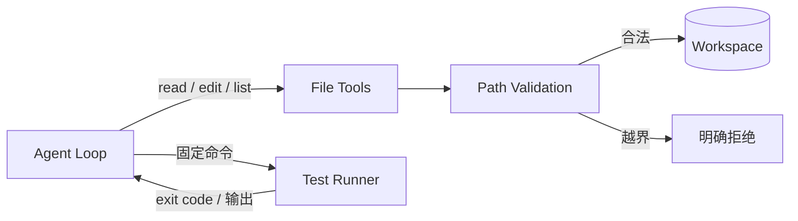

# Level 2 — 🛠️ 代码工匠

> 技术主题：Mini Coding Agent ｜ 解锁能力：Code Editing ｜ 状态：未开始

## Mission Briefing

Mini Agent 会思考、会行动，却还不会创造软件。现在你要教它阅读代码、修改文件、运行测试、检验自己的工作。这不是赋予它无限权力——它的每次文件操作都被限制在一间可信的教学工作区里，每条可执行的命令都来自白名单。当它第一次独立修复一个 Bug 并让测试变绿时，它成为了真正的代码工匠。

## Main Quest

- 实现 `read_file` / `write_file` / `edit_file` / `list_dir` 四个文件工具。
- 工作区边界：所有路径 resolve 后必须落在工作区内。
- 路径校验：拒绝 `..` 穿越、绝对路径注入与符号链接逃逸。
- 受控测试执行：仅允许预定义的固定测试命令，不执行模型生成的任意 Shell。
- 完成一个可复现的教学 Bug 修复任务：发现 → 修改 → 测试验证。

## Skills Unlocked

1. 文件工具设计与路径校验
2. 工作区边界（Workspace Boundary）
3. 受控测试执行（白名单命令）
4. 测试结果解读

## Architecture



## Build

| 模块 | 位置 | 说明 |
|---|---|---|
| 文件工具 | `tools/` | 四个工具 + 共用路径校验 |
| 教学工作区 | `examples/workspace/` | 含已知 Bug 的可信小项目 |
| Bug 修复 Demo | `examples/level2_bugfix_demo.py` | 端到端修复流程 |
| 测试 | `tests/level2/` + `tests/security/` + `tests/boss/` | 功能 + 越界 + Boss |

## Run

> 计划中的运行方式，实现后以真实输出替换。
> **约束：Level 3 完成前，只允许在可信、可审查的教学工作区运行固定命令，不执行不可信代码。**

```bash
python -m examples.level2_bugfix_demo
pytest tests/level2 tests/security -v
```

## Key Code

路径校验函数（解析真实路径 → 比对工作区前缀 → 识别符号链接逃逸）约 20–50 行，本关安全性全系于此。

## Boss Challenge

构造攻击样本：`../../etc/passwd` 式穿越、指向工作区外的符号链接、绝对路径注入。全部必须被拒绝，且拒绝原因可追踪。

## Victory Conditions

- [ ] 可复现地完成一个教学 Bug 修复任务
- [ ] 所有文件操作限制在工作区内，穿越测试通过
- [ ] 符号链接边界有明确测试
- [ ] 仅执行白名单固定测试命令
- [ ] 未将路径校验宣传为强安全隔离（文档明确说明其局限）

## Personal Mastery

- 解释：为什么「`os.path.join` + 字符串前缀检查」不够？`resolve()` 之后发生了什么？
- 指出：路径校验的关键代码段。
- 修改：独立新增一个 `grep_file` 工具，复用同一套校验。
- 预测：为什么 Level 3 之前只允许在可信工作区运行固定命令？

## Rewards

| 项目 | 值 |
|---|---|
| XP 上限 | 100 |
| 成就 | **Code Smith** — 代码工匠 |
| 成就等级 | Builder / Engineer / Master |
| Milestone | `v0.3.0` |

## Learning Notes

> 完成后记录：校验实现细节、Boss 攻击样本与防御对照、边界设计心得。
