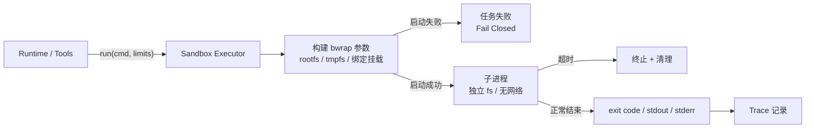

# Level 3 — 🛡️ 安全堡垒

> 技术主题：Linux Sandbox Executor ｜ 解锁能力：Sandboxed Execution ｜ 状态：未开始

## Mission Briefing

Mini Agent 已经能修改并运行代码，但自由即风险：一条失控的命令就可能伤及宿主。你要为它建造一座堡垒——独立的文件系统视图、被切断的网络、严格的超时与善后流程。堡垒的门只有一个入口，且 Fail Closed：如果堡垒本身无法建成，任务宁可失败，也绝不裸奔。当死循环被熔断、逃逸被挡下，Mini Agent 终于可以放心奔跑。

## Main Quest

- 基于 `subprocess` 实现 Executor 基础生命周期：启动 / 超时 / 取消 / 清理。
- 集成 Bubblewrap + Linux Namespace：文件系统隔离、网络隔离。
- 资源限制与 `stdout` / `stderr` / exit code 采集。
- Fail Closed：Sandbox 启动失败时任务直接失败，不退化到无隔离执行。
- 区分「执行成功」与「任务成功」，完整记录退出码、超时与错误原因。

## Skills Unlocked

1. Linux 进程生命周期与 subprocess
2. Namespace 与 Bubblewrap 隔离
3. 超时、取消与进程清理
4. Fail Closed 设计

## Architecture



## Build

| 模块 | 位置 | 说明 |
|---|---|---|
| Executor | `sandbox/` | subprocess 生命周期管理 |
| bwrap 集成 | `sandbox/` | 参数构建 + 环境探测 |
| Demo | `examples/level3_sandbox_demo.py` | 隔离 / 超时 / Fail Closed 演示 |
| 测试 | `tests/level3/` + `tests/boss/` | 隔离验证 + 五类故障 |

## Run

> 计划中的运行方式，实现后以真实输出替换。
> **环境约束：Bubblewrap 实验要求兼容的 Linux 环境。不支持的系统必须明确提示不可运行，不自动降级为无隔离执行。**

```bash
pytest tests/level3 -v
python -m examples.level3_sandbox_demo
```

## Key Code

「启动失败 → Fail Closed」与「超时 → 终止 → 清理」两条路径的 20–50 行代码。

## Boss Challenge

1. 死循环程序被超时熔断
2. 访问沙箱外文件被隔离
3. 尝试网络访问失败
4. bwrap 缺失时任务 Fail Closed 而非裸跑
5. 子进程残留被正确清理

## Victory Conditions

- [ ] 文件系统隔离测试通过
- [ ] 网络隔离测试通过
- [ ] 超时任务被终止，子进程无残留
- [ ] Sandbox 启动失败 Fail Closed
- [ ] 退出码、超时、错误原因均有记录
- [ ] 执行成功与任务成功被明确区分
- [ ] 文档说明 Bubblewrap 的环境依赖与限制

## Personal Mastery

- 解释：Namespace 各自隔离了什么？为什么 Fail Closed 比 Fail Open 正确？
- 指出：进程清理的关键代码段。
- 修改：独立新增一项资源限制并验证生效。
- 预测：把超时从 5s 改成 1s，哪些测试行为会变化？

## Rewards

| 项目 | 值 |
|---|---|
| XP 上限 | 100 |
| 成就 | **Guardian** — 安全守护者 |
| 成就等级 | Builder / Engineer / Master |
| Milestone | `v0.4.0` |

## Learning Notes

> 完成后记录：隔离验证方法、清理策略、Linux 环境踩坑。
