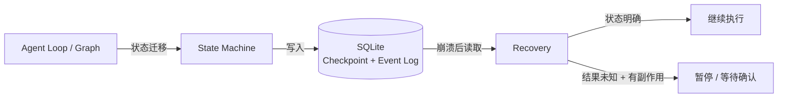

# Level 4 — 💾 时间回溯

> 技术主题：State Machine + Checkpoint ｜ 解锁能力：Crash Recovery ｜ 状态：未开始

## Mission Briefing

Mini Agent 已经能承担复杂任务，但一次进程崩溃就可能吞掉所有进度。你要给它一本「时间之书」：每次 Run、每一步、每次工具调用都记录在 SQLite 中，状态机清楚区分「未开始」「已完成」与「结果未知」。崩溃不是终点——重启之后，Runtime 读取书页续写故事；而对结果未知的副作用操作，它学会了一件事：不盲目重试。

## Main Quest

- 定义 Run / Step / ToolCall 数据模型与状态机。
- SQLite 持久化：Checkpoint（快照）+ Event Log（追加式事实序列）。
- 实现崩溃恢复：重启后读取 Checkpoint，恢复执行或安全终止。
- 幂等性与重试策略：结果未知的有副作用操作不自动重试，暂停等待确认或按明确策略处理。
- 可复现的崩溃注入测试。

## Skills Unlocked

1. 状态机建模（Run / Step / ToolCall）
2. SQLite Checkpoint 与 Event Log
3. 幂等性与重试策略
4. 未知结果处理

## Architecture



## Build

| 模块 | 位置 | 说明 |
|---|---|---|
| 数据模型与状态机 | `runtime/` | Run / Step / ToolCall |
| 持久化层 | `runtime/` | SQLite checkpoint / event |
| 恢复逻辑 | `runtime/` | 启动时恢复或安全终止 |
| 崩溃注入 Demo | `examples/level4_crash_demo.py` | 运行中 kill → 重启恢复 |
| 测试 | `tests/level4/` | 可复现崩溃恢复 |

## Run

> 计划中的运行方式，实现后以真实输出替换。

```bash
python -m examples.level4_crash_demo   # 运行中手动 kill，再重启观察恢复
pytest tests/level4 -v
```

## Key Code

状态迁移表 + 「结果未知」分支的处理逻辑（20–50 行）。

## Boss Challenge

工具已产生副作用（如已写入文件），但 Runtime 在记录结果前崩溃。要求：重启后该步骤被标记为「结果未知」，系统不盲目重试，而是暂停等待确认或按明确策略处理。

## Victory Conditions

- [ ] 任务状态与 Checkpoint 可查询
- [ ] 能区分未开始 / 已完成 / 结果未知
- [ ] 结果未知的有副作用操作不被盲目重试
- [ ] 崩溃恢复测试可复现
- [ ] 文档不声称实现通用 Exactly-Once 语义

## Personal Mastery

- 解释：Checkpoint 与 Event Log 各自回答什么问题？为什么恢复不等于重放？
- 指出：状态迁移表关键段。
- 修改：独立新增一个状态并说明其对恢复流程的影响。
- 预测：在哪个时机 kill 进程会制造出「结果未知」？

## Rewards

| 项目 | 值 |
|---|---|
| XP 上限 | 100 |
| 成就 | **Time Keeper** — 时间守护者 |
| 成就等级 | Builder / Engineer / Master |
| Milestone | `v0.5.0` |

## Learning Notes

> 完成后记录：状态机设计取舍、崩溃注入方法、幂等性理解。
