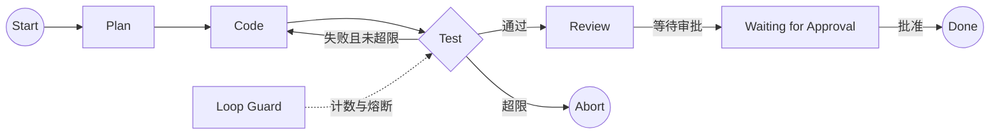

# Level 5 — 🗺️ 命运之图

> 技术主题：Graph Orchestration ｜ 解锁能力：Workflow Orchestration ｜ 状态：未开始

## Mission Briefing

Mini Agent 能独立完成任务，但复杂工作需要规划、编码、测试与审查各司其职。你要绘制一张命运之图：任务化作节点，边决定走向——测试失败折返代码，审批未至原地等待。图不是孤立的魔法：它复用 Level 4 的持久化与状态机，节点之内还能驱动 Agent Loop。当工作流在循环守卫下优雅停机，你已是真正的编织者。

## Main Quest

- 实现 Workflow Graph：Node / Edge / Shared State / 条件路由。
- 示例工作流：Plan → Code → Test → Review（Test 失败 → Code；Review 挂起等待审批）。
- Loop Guard：最大循环次数限制，防止无限折返。
- 与 Checkpoint 集成：工作流状态可持久化、可恢复。
- Human-in-the-loop：审批暂停与恢复。
- **架构约束**：与 Agent Loop 共享 Run / Step / Event / ToolResult 数据模型，Graph Node 可调用 Agent Loop；不使用 LangGraph 实现核心编排。

## Skills Unlocked

1. Workflow Graph 建模（Node / Edge / 共享状态）
2. 条件路由
3. Loop Guard 与节点失败处理
4. Human-in-the-loop

## Architecture



## Build

| 模块 | 位置 | 说明 |
|---|---|---|
| Graph 引擎 | `orchestration/` | Node / Edge / 路由 / Loop Guard |
| 示例工作流 | `examples/level5_workflow_demo.py` | Plan-Code-Test-Review |
| 审批集成 | `orchestration/` + `runtime/` | 暂停 / 恢复 |
| 测试 | `tests/level5/` | 路由 / 循环 / 审批 |

## Run

> 计划中的运行方式，实现后以真实输出替换。

```bash
python -m examples.level5_workflow_demo
pytest tests/level5 -v
```

## Key Code

条件路由 + Loop Guard 的判定逻辑（20–50 行）。

## Boss Challenge

构造「测试永远失败」的工作流：Loop Guard 在达到上限后终止流程并生成可追踪的失败报告，而不是无限折返或静默丢弃。

## Victory Conditions

- [ ] 条件路由与共享状态传递正确
- [ ] 最大循环次数限制生效
- [ ] 节点失败可追踪
- [ ] 工作流可持久化、可恢复
- [ ] 人工审批可暂停并恢复工作流
- [ ] 能解释 Agent Loop / Graph Orchestration / Task Scheduling 的区别
- [ ] Agent Loop 与 Graph Engine 共享基础数据模型，未使用 LangGraph

## Personal Mastery

- 解释：图引擎如何复用 Level 4 的状态机？Node 内调用 Agent Loop 的边界在哪？
- 指出：路由判定关键段。
- 修改：独立新增一个节点（如 Lint）并接入路由。
- 预测：把 Loop Guard 上限从 3 改为 1，Boss 战行为如何变化？

## Rewards

| 项目 | 值 |
|---|---|
| XP 上限 | 100 |
| 成就 | **Fate Weaver** — 工作流编织者 |
| 成就等级 | Builder / Engineer / Master |
| Milestone | `v0.6.0` |

## Learning Notes

> 完成后记录：图建模取舍、与 Agent Loop 的复用关系、审批暂停恢复设计。
