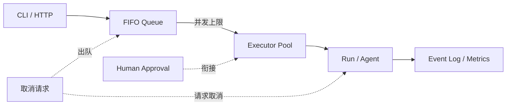

# Level 6 — 🏰 指挥中心

> 技术主题：Mini AgentOS ｜ 解锁能力：Task Management and Scheduling ｜ 状态：未开始

## Mission Briefing

编排已通，但任务一多，指挥就会混乱：谁先执行？并发多少？排队的能否取消？运行中的如何叫停？你要把整座指挥中心建起来——FIFO 队列、并发上限、超时熔断、审批衔接，外加一本记录所有任务生命周期的事件日志。当多个任务在队列中井然有序地进出，Mini Agent 不再是孤胆英雄，而是一支有纪律的部队。

## Main Quest

- 定义 Task / Run / Session 层级。
- FIFO 任务队列 + 并发上限的调度器。
- 排队任务取消（立即出队）；运行中任务请求取消，并**如实报告**最终结果。
- 任务超时处理与审批状态衔接。
- 事件日志与基础指标（排队时长、执行时长、失败数）。
- CLI 或最小 HTTP API（标准库实现）。

## Skills Unlocked

1. 任务队列与调度策略（FIFO）
2. 并发控制
3. 取消语义（排队 vs 运行中）
4. 可观测性与基础指标

## Architecture



## Build

| 模块 | 位置 | 说明 |
|---|---|---|
| 调度器 | `runtime/` | 队列 / 并发 / 超时 / 取消 |
| API 入口 | `examples/level6_agentos_demo.py` | CLI + 可选最小 HTTP |
| 指标 | `runtime/` | 基础计数与时长 |
| 测试 | `tests/level6/` + `tests/boss/` | 调度 / 取消 / 竞争 |

## Run

> 计划中的运行方式，实现后以真实输出替换。

```bash
python -m examples.level6_agentos_demo submit --name task-a
python -m examples.level6_agentos_demo status
pytest tests/level6 -v
```

## Key Code

调度主循环（取队首 → 并发判断 → 提交执行 → 状态回写）的 20–50 行。

## Boss Challenge

并发提交多个任务制造资源竞争；同时取消排队任务（应立即出队）与运行中任务（应请求取消，并如实报告最终是「已取消」还是「已完成」）。

## Victory Conditions

- [ ] FIFO 调度顺序正确
- [ ] 最大并发数限制生效
- [ ] 排队任务可取消
- [ ] 运行中任务取消结果被如实报告
- [ ] 任务超时有明确处理
- [ ] 审批状态与调度状态正确衔接
- [ ] 事件日志可还原任务生命周期
- [ ] 未提前实现分布式队列

## Personal Mastery

- 解释：取消排队任务与取消运行中任务的语义差异；为什么结果要「如实报告」？
- 指出：调度主循环关键段。
- 修改：独立调整并发上限并预测行为。
- 预测：运行中任务忽略取消请求时，最终状态是什么？

## Rewards

| 项目 | 值 |
|---|---|
| XP 上限 | 100 |
| 成就 | **Commander** — Agent 指挥官 |
| 成就等级 | Builder / Engineer / Master |
| Milestone | `v0.7.0` |

## Learning Notes

> 完成后记录：调度策略选择、取消语义设计、指标体系。
