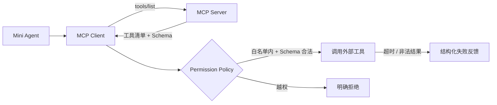

# Level 7 — 🔌 能力之门

> 技术主题：MCP / Skills ｜ 解锁能力：Extensible Tool Ecosystem ｜ 状态：未开始

## Mission Briefing

Mini Agent 的运行系统已经稳固，但它的工具仍是与生俱来的少数几件。你要打开能力之门：让外部世界以 MCP 协议送来新工具——被发现、被校验、被授权后才能使用。门是单向受控的：门外的工具再强大，也是不可信的客人。超时要熔断、非法结果要拦截、越权请求要拒绝。当自定义 MCP Server 的新工具第一次被安全调用，能力之门正式贯通。

## Main Quest

- 实现 MCP Client：连接 Server、工具发现（`tools/list`）、工具调用。
- 实现一个最小 MCP Server 作为教学示例。
- Schema 校验与版本兼容策略。
- 权限策略：外部工具默认不可信，按白名单授权。
- Skills 概念引入，并说清 MCP / Tool / Skill 的边界。
- 外部工具失败（超时 / 非法结果 / 越权）的明确反馈。

## Skills Unlocked

1. MCP 协议与 Client / Server
2. 工具发现与 Schema 版本化
3. 外部信任边界与权限策略
4. Tool / Skill / MCP 概念辨析

## Architecture



## Build

| 模块 | 位置 | 说明 |
|---|---|---|
| MCP Client | `tools/` | 发现 / 调用 / 超时 |
| 教学 MCP Server | `examples/mcp_server_demo/` | 提供 1–2 个演示工具 |
| 权限集成 | `tools/` | 沿用白名单策略 |
| 测试 | `tests/level7/` | 发现 / 校验 / 失败注入 |

## Run

> 计划中的运行方式，实现后以真实输出替换。

```bash
python -m examples.level7_mcp_demo
pytest tests/level7 -v
```

## Key Code

「发现 → 校验 → 授权 → 调用」链路中权限与校验的 20–50 行。

## Boss Challenge

外部工具超时、返回违反 Schema 的非法结果、请求未授权操作——三种情况都必须有明确反馈，且不污染本地工具状态。

## Victory Conditions

- [ ] 工具发现成功
- [ ] Schema 校验正常（含版本兼容策略）
- [ ] 外部工具失败有明确反馈
- [ ] 权限策略对外部工具仍然生效
- [ ] 能解释 MCP / Tool / Skill 的区别
- [ ] MCP 工具未被天然视为可信

## Personal Mastery

- 解释：外部工具与内置工具的信任差异体现在哪些代码路径？
- 指出：外部结果校验关键段。
- 修改：独立接入一个新 MCP Server。
- 预测：Server 返回缺少版本字段的 Schema 时会发生什么？

## Rewards

| 项目 | 值 |
|---|---|
| XP 上限 | 100 |
| 成就 | **Portal Master** — 能力探索者 |
| 成就等级 | Builder / Engineer / Master |
| Milestone | `v0.8.0` |

## Learning Notes

> 完成后记录：协议理解、信任边界设计、Schema 版本化策略。
