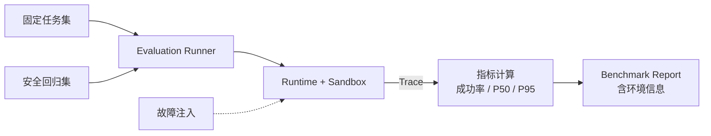

# Level 8 — 🏆 终极试炼

> 技术主题：Evaluation / Benchmark ｜ 解锁能力：Measurable Reliability ｜ 状态：未开始

## Mission Briefing

能力齐备，但「演示成功」不等于「系统可靠」。最后一关没有新武器——你要为 Mini Agent 建立一座试炼场：固定的任务集、真实的指标、可复现的故障注入。成功率、P50 / P95 延迟、失败原因分布，每一个数字都必须来自真实运行。当报告生成的那一刻你会明白：可靠的系统不是被吹出来的，是被测出来的。Runtime Master 的称号，属于让系统说真话的人。

## Main Quest

- 固定评估任务集，可重复运行。
- 指标采集：任务成功率、工具执行成功率、延迟 P50 / P95。
- 并发 Benchmark 与故障注入（工具失败 / 超时 / 任务中断混合）。
- 安全回归测试：Level 2/3/7 积累的越界与逃逸用例整体回归。
- Trace 分析与 Benchmark 报告：含硬件、软件版本与环境信息。

## Skills Unlocked

1. Agent Evaluation 方法与任务集设计
2. 延迟与成功率度量（P50 / P95）
3. 故障注入与安全回归
4. 报告与可复现性

## Architecture



## Build

| 模块 | 位置 | 说明 |
|---|---|---|
| 评估框架 | `runtime/` + `tests/level8/` | 任务集 / Runner / 指标 |
| 故障注入 | `tests/level8/` | 可复现注入器 |
| 报告生成 | `examples/level8_benchmark_demo.py` | Markdown / JSON 报告 |
| 安全回归 | `tests/security/` | 历史越界用例集合 |

## Run

> 计划中的运行方式，实现后以真实输出替换。

```bash
python -m examples.level8_benchmark_demo --suite smoke
pytest tests/level8 tests/security -v
```

## Key Code

指标聚合（原始事件 → 成功率 / 分位数）的 20–50 行。

## Boss Challenge

并发压力下混合注入：部分任务工具失败、部分超时、部分中途取消。要求：报告如实反映混合结果，失败原因可归类、可复现。

## Victory Conditions

- [ ] 固定任务集可重复运行
- [ ] 成功率统计正确，延迟指标来自真实运行
- [ ] 故障注入可复现
- [ ] 安全回归测试全部通过
- [ ] 报告包含硬件、软件版本与测试环境信息
- [ ] 不虚构性能数据，不将一次成功演示等同于生产级可靠性

## Personal Mastery

- 解释：为什么「演示成功」不能证明「系统可靠」？P95 意味着什么？
- 指出：分位数计算关键段。
- 修改：独立新增一个评估任务到任务集。
- 预测：注入比例翻倍后，成功率大约如何变化？先猜再测。

## Rewards

| 项目 | 值 |
|---|---|
| XP 上限 | 100 |
| 成就 | **Runtime Master** — 终极架构师 |
| 成就等级 | Builder / Engineer / Master |
| Milestone | `v0.9.0` |

## Learning Notes

> 完成后记录：指标解读、故障注入设计、全程复盘。
